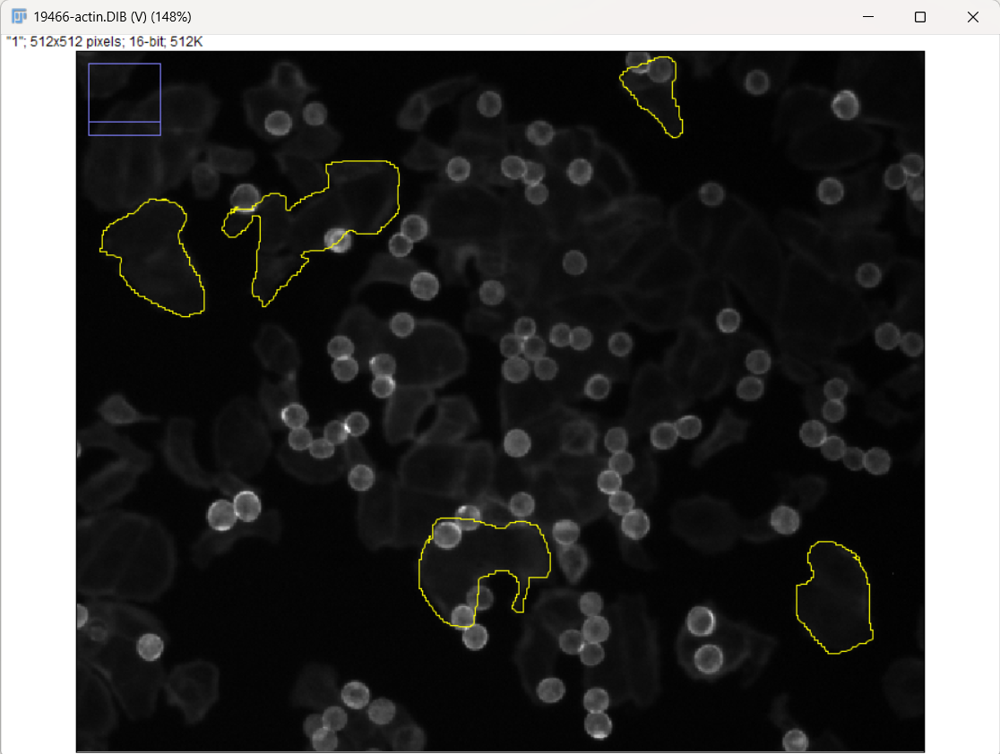
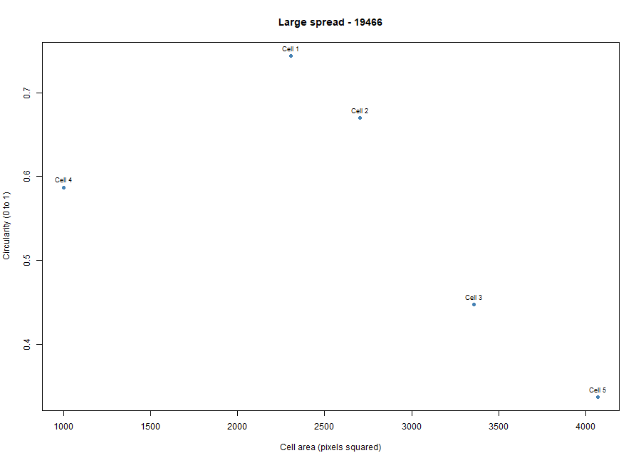
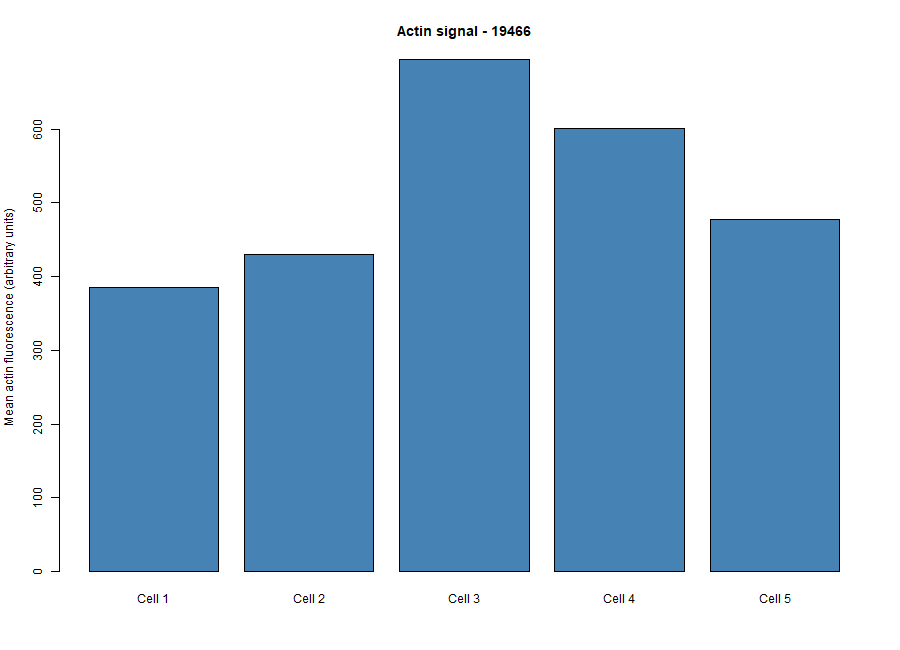

# Cytoskeleton and Cell Morphology – BBBC018

## Student Information

- **Student:** Kyla Rose D. Villegas
- **Student ID:** 202400772
- **Course/Section:** BIO 300 – Cell and Molecular Biology, Section B
- **Chosen phenotype:** Large spread
- **Image-field ID:** 19466

## Project Overview

This activity examines cell morphology and F-actin staining in fluorescence images of HT29 human colon-cancer cells. I selected the **Large spread** phenotype based on the broad, spread-out appearance of the cells in the actin image.

The analysis involved measuring five cells in Fiji/ImageJ and analyzing cell area, circularity, aspect ratio, and mean actin fluorescence using R.

## BBBC018 Image Information

- **Dataset:** BBBC018v1
- **Image field:** 19466
- **Actin image:** `19466-actin.DIB`
- **DNA image:** `19466-DNA.DIB`
- **Phenotype:** Large spread

The phenotype was determined by visual appearance and was not based on the image filename.

## Fiji/ImageJ Measurements

Five cells were outlined using the Freehand Selection tool in Fiji/ImageJ.

The measurements included:

- Cell area
- Mean actin fluorescence
- Circularity
- Aspect ratio

The five measured cells were saved in `data/fiji_results.csv`.

## Results

The mean measurements for the five cells were:

| Measurement | Mean |
|---|---:|
| Cell area | 2687 pixels² |
| Circularity | 0.557 |
| Aspect ratio | 1.7196 |
| Mean actin signal | 517.6908 |

The circularity values showed variation among the five cells, while the average aspect ratio of 1.7196 indicates that the cells were generally more elongated than perfectly round.

## Figures

### Measured Cells

The five cells selected and outlined in Fiji are shown below.



### Cell Area vs. Circularity

This plot shows the relationship between cell area and circularity for the five measured cells.



### Actin Intensity

This bar graph shows the mean actin fluorescence of each measured cell.



## Questions and Answers

### 1. Which specific phenotype did you choose, and what visible features support that choice?

I chose the **Large spread** phenotype. The cells appear broad and spread out, with relatively large cell areas and extended cell boundaries.

### 2. Were your five cells mostly round or elongated?

The five cells were generally **more elongated than perfectly round**. Their mean circularity was 0.557 and their mean aspect ratio was 1.7196, showing variation in cell shape.

### 3. What role does actin play in maintaining cell shape and in cell movement?

Actin filaments help maintain cell shape by forming supportive structures within and near the cell membrane. Actin also contributes to cell movement by reorganizing and producing forces that change the shape and position of the cell.

### 4. Why can a single fixed fluorescence image NOT show how fast a cell moves?

A single fixed fluorescence image shows the appearance of cells at only one point in time. It does not provide a time sequence, so it cannot be used to determine how far or how fast a cell moves.

## Project Files

```text
data/
└── fiji_results.csv

figures/
├── measured_cells.png
├── area_vs_circularity.png
└── actin_intensity.png

results/
└── cell_summary.csv

scripts/
└── analyze_cells.R
